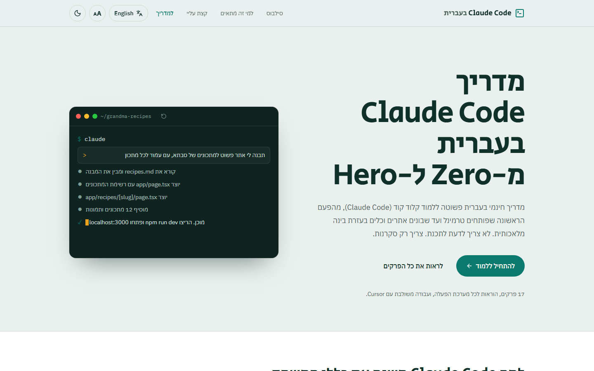
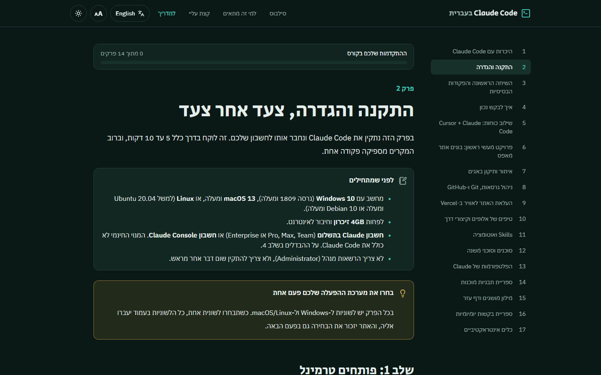
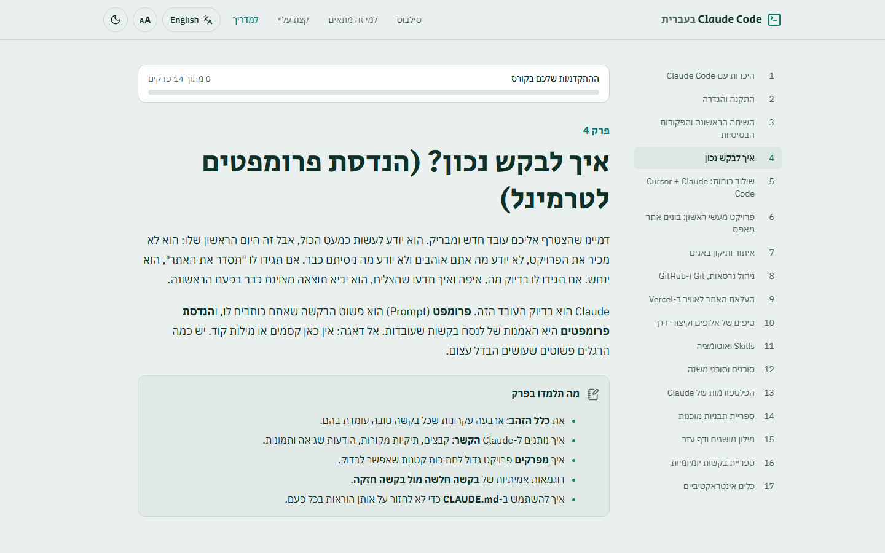
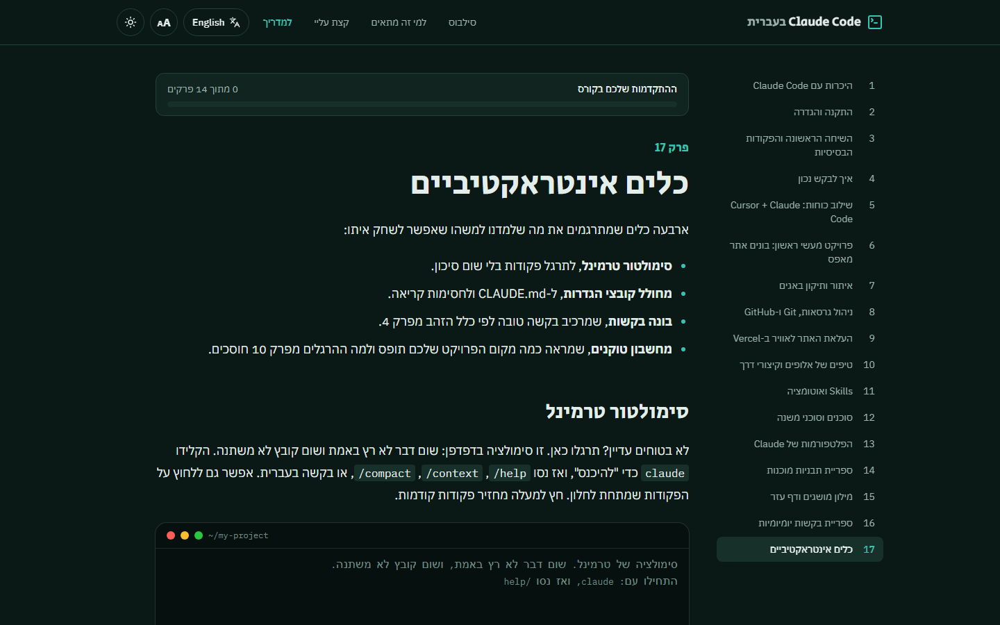
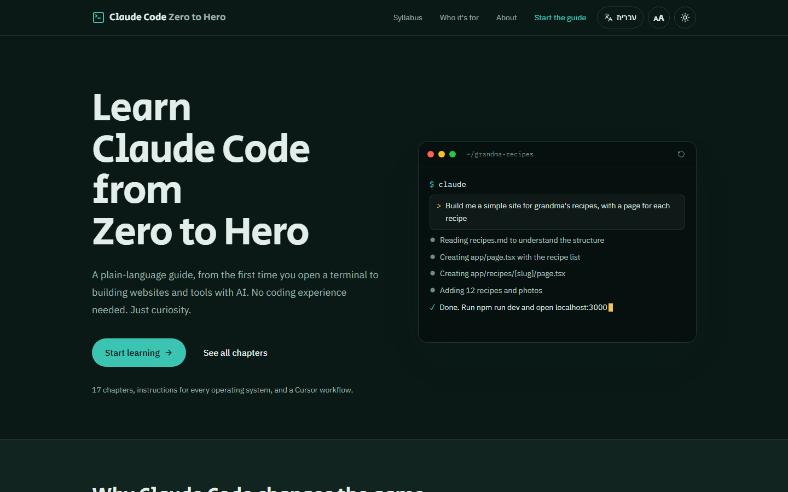

<div align="center">

# Claude Code in Hebrew: Zero to Hero

**A free, bilingual (Hebrew RTL + English) interactive course that teaches non-developers to build and ship real websites with Claude Code.**

[](https://www.claude-code-hebrew.com)
[](https://www.claude-code-hebrew.com/en)


[**עברית**](README.he.md) · [Live demo](https://www.claude-code-hebrew.com) · [Features](#features) · [Engineering highlights](#engineering-highlights) · [Run locally](#run-locally)

<br />



</div>

---

## At a glance

| | |
| --- | --- |
| 📚 **18 chapters** | From "what is a terminal?" to Skills, sub-agents and deploying to Vercel |
| 🌍 **2 languages** | Full Hebrew (RTL) and English (LTR) editions, same URL structure, one-click switch |
| 🛠️ **4 in-browser tools** | Terminal simulator, `CLAUDE.md` generator, prompt builder, token calculator |
| 💻 **3 platforms** | Synced OS tabs for PowerShell, CMD and macOS/Linux on every install step |
| 🔍 **SEO-ready** | Per-locale metadata, `hreflang`, JSON-LD, dynamic OG images, sitemap |

## Why I built it

Claude Code is changing how software gets built, but almost all the learning material is in English and written for developers. I wanted my friends and family, people who have never opened a terminal, to be able to build their own websites. So I wrote a course in plain Hebrew, designed RTL-first, and later added a full English edition.

The project itself was built **with** Claude Code, following the same workflow it teaches: a project-level [`CLAUDE.md`](CLAUDE.md), small reviewable diffs, and Git + Vercel for every release.

## Screenshots

<table>
  <tr>
    <td width="50%"></td>
    <td width="50%"></td>
  </tr>
  <tr>
    <td align="center"><sub>Chapter page: RTL sidebar, progress tracker, callouts (dark mode)</sub></td>
    <td align="center"><sub>Prompting guide (light mode)</sub></td>
  </tr>
  <tr>
    <td width="50%"></td>
    <td width="50%"></td>
  </tr>
  <tr>
    <td align="center"><sub>Interactive tools: in-browser terminal simulator</sub></td>
    <td align="center"><sub>English edition (LTR)</sub></td>
  </tr>
</table>

## Features

**For learners**

- **RTL-first design**: layout, navigation and typography built for Hebrew from day one, not flipped after the fact.
- **OS-aware instructions**: tabs for PowerShell, CMD and macOS/Linux. Pick once and every tab group on the page follows, and the choice is remembered.
- **Copy-to-clipboard code blocks** with syntax highlighting (Shiki) and file/OS labels.
- **Ready-made Hebrew prompts** and side-by-side "weak vs. strong prompt" comparisons.
- **Progress tracking**: persistent checklists and end-of-chapter quizzes feed a course-wide progress bar.
- **Searchable glossary** and a library of everyday prompts.
- **Accessibility**: dark/light mode, a 3-step font-size control applied before first paint, semantic headings and keyboard-friendly components.
- **Feedback survey** at the end of the course.

**Interactive tools (chapter 17)**

| Tool | What it does |
| --- | --- |
| Terminal simulator | Practice `claude`, `/help`, `/context`, `/compact` safely in the browser |
| `CLAUDE.md` generator | Builds a project instructions file from a few questions |
| Prompt & Skill builder | Turns a vague request into a structured prompt, following chapter 4 |
| Token calculator | Estimates how much of the context window a project uses |

## Engineering highlights

- **Bilingual routing with Next.js route groups**: `app/(he)` and `app/(en)` each have their own root layout, so `<html lang dir>` is correct on the server with no client-side flip. Chapters share slugs across languages, and the language switch keeps you on the same chapter.
- **Content as data**: chapters are MDX files. A single typed syllabus ([`lib/syllabus.ts`](lib/syllabus.ts)) drives the sidebar, landing page, progress tracker and sitemap. All UI strings live in one dictionary ([`lib/ui.ts`](lib/ui.ts)).
- **Custom MDX component library**: `Callout`, synced `Tabs`, `Prompt`, `PromptCompare`, `Checklist`, `MiniQuiz`, `Library`, `RecapCards` and more, registered once in [`mdx-components.tsx`](mdx-components.tsx).
- **SEO**: per-locale metadata, `hreflang` alternates, JSON-LD structured data, generated Open Graph images per locale, `robots.ts` and `sitemap.ts`.
- **No flash of wrong state**: theme and font size are applied by an inline script before hydration.
- **Static-first**: every chapter is pre-rendered at build time and served from Vercel's CDN.

## Tech stack

| Layer | Choice |
| --- | --- |
| Framework | [Next.js 15](https://nextjs.org) (App Router, Turbopack) + React 19 |
| Language | TypeScript 5 |
| Styling | [Tailwind CSS 4](https://tailwindcss.com), CSS variables for theming |
| Content | [MDX](https://mdxjs.com) + [rehype-pretty-code](https://rehype-pretty.pages.dev) / [Shiki](https://shiki.style), remark-gfm, rehype-slug |
| UI | [Lucide](https://lucide.dev) icons, [next-themes](https://github.com/pacocoursey/next-themes) |
| Hosting | [Vercel](https://vercel.com) |
| AI pair-programmer | [Claude Code](https://code.claude.com) |

## Project structure

```text
app/
├── (he)/            # Hebrew root layout, landing page and /docs/[slug]
├── (en)/en/         # English root layout, landing page and /en/docs/[slug]
├── og/[locale]/     # Dynamic Open Graph images
├── robots.ts
└── sitemap.ts
content/
├── docs/            # Hebrew chapters (MDX)
└── docs-en/         # English chapters, same file names
components/          # Header, sidebar, interactive tools, MDX components
lib/                 # syllabus, i18n, UI strings, SEO helpers, progress tracking
mdx-components.tsx   # Markdown element styling + MDX component registry
```

## Run locally

Requires Node.js 20+.

```bash
git clone https://github.com/2wito/claude-zero-2-hero.git
cd claude-zero-2-hero
npm install
npm run dev        # http://localhost:3000
```

| Command | Description |
| --- | --- |
| `npm run dev` | Dev server with hot reload |
| `npm run build` | Production build |
| `npm run start` | Serve the production build |
| `npm run lint` | ESLint |

Adding a chapter and the full MDX component reference are documented in the [Hebrew README](README.he.md#הוספת-פרק-חדש).

## About me


**Itay Twito**: I designed, wrote and built this project end to end, from the course curriculum and Hebrew/English content to the UI, interactive tools, i18n architecture, SEO and deployment.

[](https://www.linkedin.com/in/itay-twito/)
[](https://www.claude-code-hebrew.com)

<br clear="right" />

## Credits & disclaimer

Content is based on the [official Claude Code documentation](https://code.claude.com/docs/en/overview) and inspired by community guides: [claudehero.com](https://claudehero.com), [zero2claude.dev](https://zero2claude.dev) and [claude-world.com](https://claude-world.com/articles/claude-code-complete-guide-2026/). Full list in [`sources/references.md`](sources/references.md).

This is an **unofficial community guide**, not affiliated with or endorsed by Anthropic or Anysphere (Cursor). Claude and Claude Code are trademarks of Anthropic.
